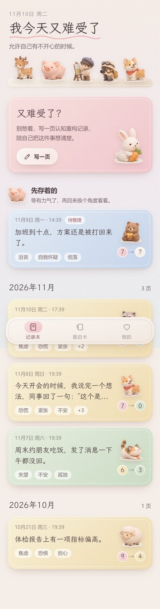
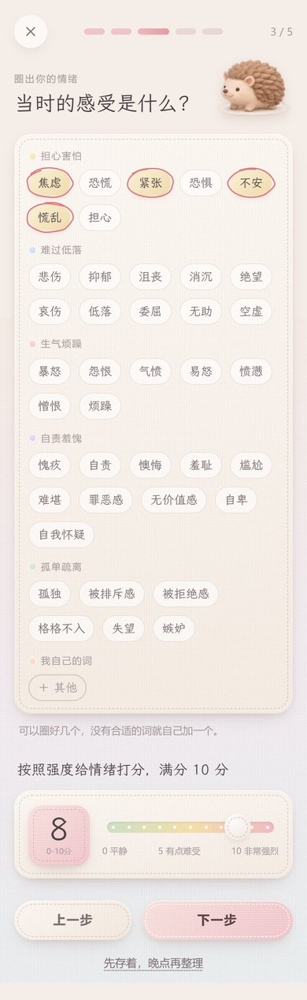
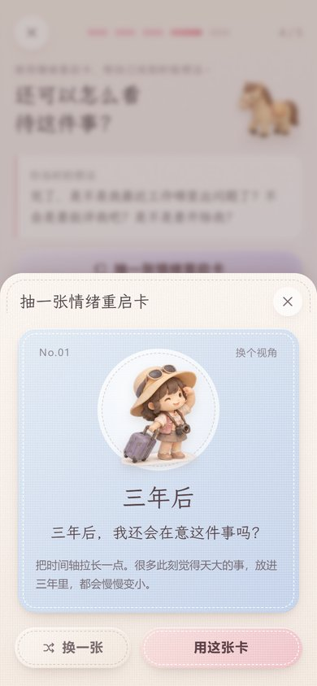
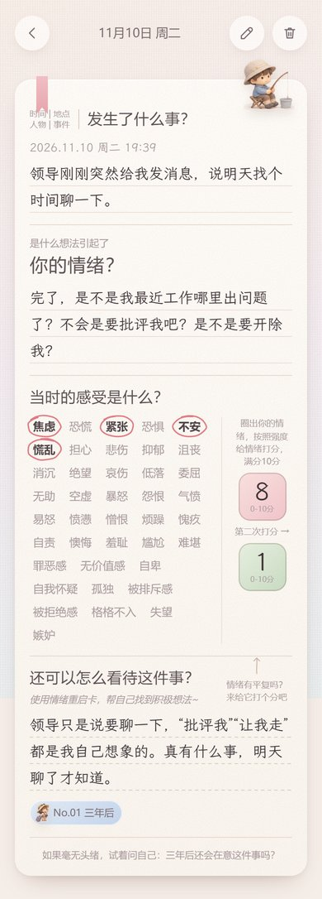
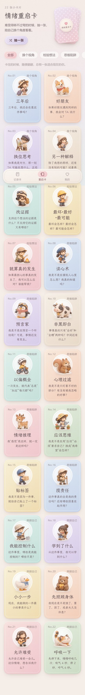
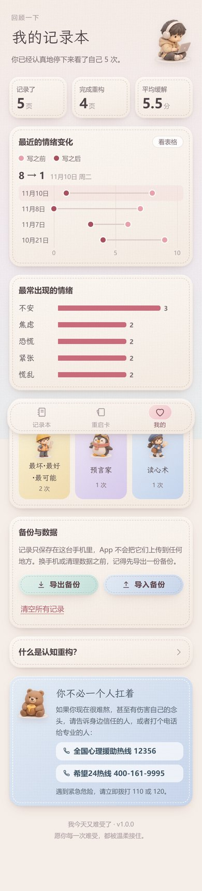
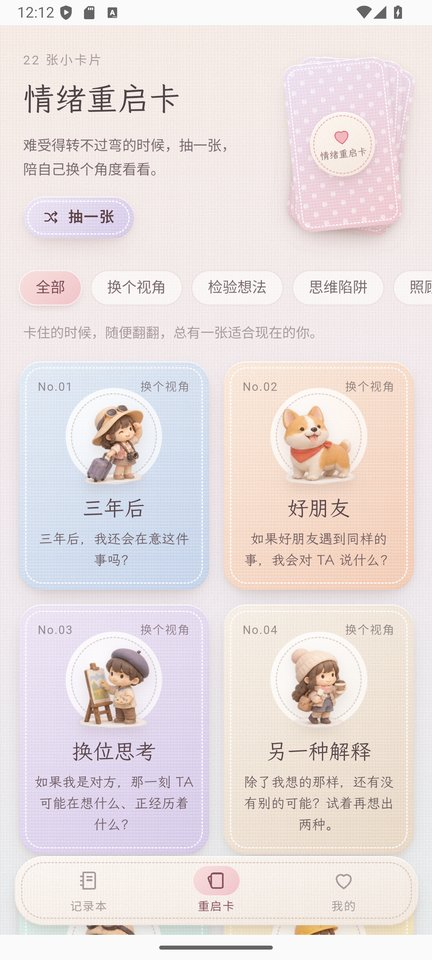

# 我今天又难受了

一本温柔的 CBT 认知重构记录本。结构照着纸质记录本来：

1. **发生了什么事？**（时间 | 地点 | 人物 | 事件）
2. **是什么想法引起了你的情绪？**
3. **当时的感受是什么？** —— 圈出情绪（手绘圈圈），按强度打分 0~10
4. **还可以怎么看待这件事？** —— 抽 **情绪重启卡** 帮自己找到更平衡的想法
5. **情绪有平复吗？** —— 第二次打分，看看前后变化

另外还有：22 张情绪重启卡（每张配一个微缩小人）、草稿自动保存、「先存着晚点再整理」、回顾统计、备份导入导出、安卓返回键处理，以及在记录里出现危险信号时温和地给出心理援助热线。

所有记录只保存在手机本地（localStorage），不联网、不上传。

| 记录本 | 圈出情绪、打分 | 抽一张重启卡 | 记录本里的一页 |
| --- | --- | --- | --- |
|  |  |  |  |

| 22 张情绪重启卡 | 我的（回顾与备份） | 安卓真机画面 |
| --- | --- | --- |
|  |  |  |

## 说明

这是自助记录工具，不能代替专业的心理咨询或治疗。
